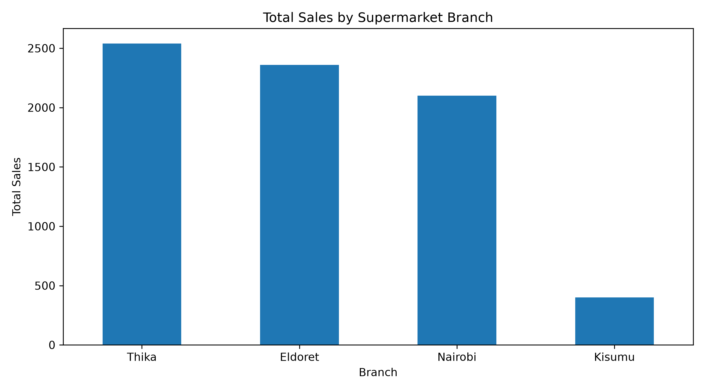

Supermarket Sales Data Analysis

Project Overview

This project demonstrates an end-to-end data cleaning and exploratory data analysis workflow using Python and Pandas.

The project uses a supermarket sales dataset containing transaction records from different branches. The objective was to clean inconsistent data, investigate data quality issues, and analyze sales performance across branches, products, customer types, and payment methods.

The analysis focuses on turning raw transaction data into useful business insights while identifying records that require further investigation.
Dataset Description

The dataset contains 28 transaction records and 10 columns.

The columns include:

Column| Description
Order_ID| Unique transaction identifier
Branch| Supermarket branch
City| City associated with the transaction
Product| Product purchased
Quantity| Number of items purchased
Price| Unit price
Total_Sales| Recorded transaction sales value
Sale_Date| Transaction date
Customer_Type| Walk-in or member
Payment_Method| Payment method used

The dataset was used to explore sales patterns and assess data quality.
Data Cleaning and Preparation

The dataset was inspected and prepared using Python and Pandas.

The cleaning process involved:

- Inspecting dataset dimensions, column names, and data types.
- Identifying missing values and duplicate records.
- Handling missing categorical values using an "Unknown" label.
- Standardizing text fields by removing unnecessary spaces and converting text to lowercase where appropriate.
- Converting transaction dates into datetime format.
- Investigating inconsistent numeric values.
- Comparing recorded sales against expected sales calculated using quantity multiplied by unit price.
- Exporting the prepared dataset into a new CSV file.

Data Quality Considerations

Some records contained missing dates and unknown categorical values. A transaction also contained a mismatch between its recorded sales value and its expected sales value.

These issues were identified as data-quality concerns requiring further investigation rather than assuming that every questionable value had an obvious correction.
## Sales Visualization

The chart below compares recorded sales values across the four supermarket branches.

Business Insights

The analysis produced the following findings:

1. Branch Performance

- Thika recorded the highest sales value at 2,540.
- Eldoret followed with 2,360.
- Kisumu recorded the lowest sales value at 400.

2. Product Performance

- Milk was the highest-selling product by sales value, contributing 3,120.
- Bread followed with 1,680.
- Water recorded 800.

3. Customer Analysis

- Walk-in customers accounted for 4,080 in sales.
- Members accounted for 3,120 in sales.

4. Payment Methods

- Cash recorded the highest sales value at 4,030.
- M-Pesa followed with 2,140.
- Card payments accounted for 1,230.

5. Overall Sales

- Total recorded sales amounted to 7,400.

Note: These figures represent recorded sales values, not necessarily verified revenue. The dataset's currency is unspecified.
Data Quality Findings

The dataset audit identified the following issues:

Quality Check| Finding
Total records| 28
Total columns| 10
Missing sale dates| 4
Unknown categorical entries| 5
Duplicate rows| 0
Duplicate Order IDs| 0
Sales calculation mismatches| 1

Important Observations

- Four transactions had missing sale dates.
- Five categorical entries were marked as "Unknown".
- No duplicate transaction IDs or duplicate rows were identified.
- One transaction (Order ID S016) recorded sales of -100, while quantity multiplied by unit price gave 100.

The transaction mismatch was flagged for investigation rather than silently corrected.

Missing dates and unknown entries were retained as data-quality limitations.

Tools and Technologies

- Python: Main programming language.
- Pandas: Data loading, cleaning, transformation, validation, and analysis.
- CSV: Data storage and export.
- Git and GitHub: Version control and project hosting.
- Streamlit: Interactive application deployment.

Skills Demonstrated

- Data inspection and exploration.
- Data cleaning and preprocessing.
- Missing-value handling.
- Duplicate detection.
- Data type conversion.
- Data validation and quality checks.
- Grouping and aggregation.
- Business insight generation.
- Version control using Git and GitHub.

Project Structure

Pandas_Mastery/
│
├── app.py
├── cleaning.py
├── concat.py
├── grading.py
├── merge().py
├── practice.py
├── Cleaned_supermarket.csv
├── supermarket_cleaning_working.csv
├── supermarket_messy_practice.csv
├── requirements.txt
└── README.md

How to Run the Project

1. Clone this repository.

2. Install the required Python packages using:
   
   pip install -r requirements.txt

3. Run the data-cleaning script:
   
   python cleaning.py

4. Launch the Streamlit application:
   
   streamlit run app.py

   Conclusion

This project demonstrates how Python and Pandas can be used to transform raw supermarket transaction data into structured information for business analysis.

Through data cleaning, validation, and exploratory analysis, the project identified sales patterns across branches, products, customer types, and payment methods.

It also highlighted the importance of investigating data-quality issues before making business decisions.

This project represents part of my ongoing journey in developing practical data analysis and programming skills.